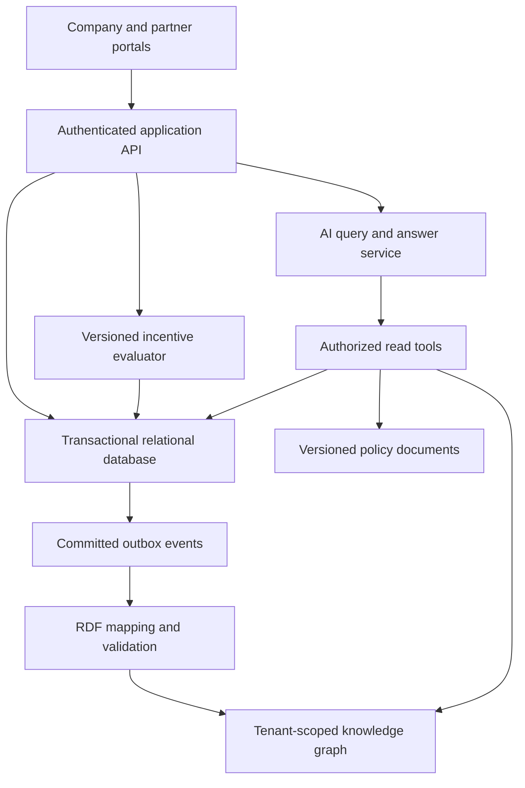
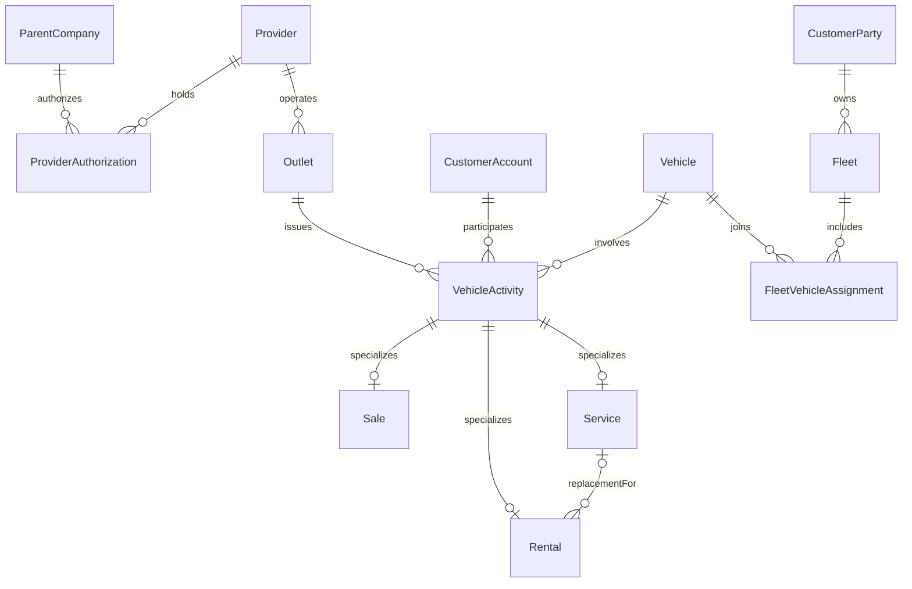

# Retail-Mesh Intelligence: application and knowledge graph plan

Planning date: November 4, 2026. Status: proposed product roadmap, not a claim that the features below are already implemented.

## 1. Product definition

Retail-Mesh is a platform where a parent company approves independent dealers, rental businesses and service providers to operate within its network. Partners record vehicle activities, the platform measures provider performance, and versioned company rules determine incentives. Each award retains the evidence needed to explain why it was granted or rejected.

Multiple parent companies can use the platform with separate permissions, programs, records and knowledge access. A provider may work with more than one parent company, subject to separate enrollment and authorization. The legal provider and each physical outlet remain distinct.

The knowledge graph connects the same operational facts across providers and time. AI helps users retrieve policy information, ask questions about authorized records and interpret measured insights. Deterministic application logic calculates financial entitlements.

### Grounding in the supplied project

- The background paper positions Retail-Mesh as an event-centered representation connecting provider activity, customer accounts, vehicles, performance and incentives. Its comparisons to VSO, Schema.org, GoodRelations and Catena-X motivate reuse and evaluation; they do not prove that Retail-Mesh is a universal first or that a graph will outperform SQL.
- The 3MT presentation describes Cedar Logistics, Northstar Horizon, Maple Motors, Harbour Service and Island Rentals. These names and the CAD 150 award are illustrative. The fleet already contains 12 vehicles before the new purchase.
- The newly uploaded 26-entity, 42-relationship ER ZIP remains the conceptual baseline. The older repository ER is excluded. The current local 34-relation implementation is a relational milestone prototype, not the full platform described here.
- The verified author names in the attached materials are Avlyn Kaur Khurana, Harish Pugazhenthi Sasikala and Krishnaswamy Gopalakrishnan. Final submission order and actual contributions still require team confirmation.

## 2. Users, permissions and tenant boundaries

| Role | Main work | Visibility |
|---|---|---|
| Platform operator | Tenant provisioning, system health, configuration | Operational metadata; business data access only through explicitly authorized support paths |
| Parent-company administrator | Approve providers/outlets, publish programs, review performance | Own company network and permitted shared evidence |
| Provider administrator | Apply for enrollment, manage outlet staff/capabilities, review earnings | Own provider records within authorized company contexts |
| Outlet staff | Enter and reconcile sales, rentals and services | Assigned outlets and approved customer records |
| Incentive reviewer | Review exceptions, approve or reject calculated awards | Assigned company's evaluations and supporting evidence |
| Finance user | Reconcile earned, approved, payable and settled amounts | Approved financial records and relevant evidence |
| Fleet/customer user | View own vehicles, bookings, service status and applicable benefits | Own customer/fleet context; add after provider workflows are stable |
| Auditor/analyst | Trace decisions and reproduce reports | Explicit read-only scope with sensitive fields controlled |

Use tenant membership plus roles and outlet scope. Do not infer authorization from a request body TenantId, a graph name, a model prompt or possession of a record ID. A provider appearing in two company networks does not grant either company access to the other's business records.

## 3. Application modules and workflows

### 3.1 Provider enrollment

Application -> submitted -> company review -> approved/rejected -> suspended/expired.

Capture the existing legal business identity, outlets, requested capabilities, evidence documents and validity dates. Parent companies approve provider membership separately from outlet capabilities. Program enrollment is another explicit, dated decision. Preserve who approved it and when.

### 3.2 Vehicle catalogue and inventory

Separate manufacturer catalogue models from physical vehicles. Validate VINs, record source identifiers, and track inventory availability and custody over time. Distinguish a published Offer from a completed Sale. Public catalogue prices are not actual transaction prices.

### 3.3 Sales

Record the customer account, issuing outlet, vehicle, source transaction reference, completion date, price, currency and status. Validate authorization and prevent duplicate source imports. Completing a sale may change inventory and fleet membership in the same business transaction. Cancellations and returns generate traceable corrections/reversals rather than erasing completed history.

### 3.4 Rentals

Booking -> reserved -> checked out -> returned -> closed/cancelled.

Prevent overlapping confirmed reservations for the same physical vehicle, handle changes atomically, and record rate, billable units, currency, collection/return timestamps and actual charge. A replacement rental explicitly references a service case and uses its own vehicle reference.

### 3.5 Service

Requested -> scheduled -> in progress -> completed/cancelled.

Store repair/work-order reference, service type, performed work, outlet, vehicle, customer account and completion evidence. Link supporting replacement rentals and relevant coverage documents. Keep requested work distinct from completed qualifying work.

### 3.6 Performance and incentives

Compute documented metrics at defined grains, such as provider/program/calendar-month, using fixed time zones and source cutoffs. Metrics include completed sales, completed services, rental utilization, cancellations, verified customer feedback and evidence completeness. Define numerators, denominators, exclusions and attribution before implementation.

Publish rule versions with effective dates and approval history. Evaluate activities or periods, save the result and evidence, and create stable entitlements only when all requirements are satisfied. Add review, settlement and dispute workflows incrementally.

### 3.7 Knowledge explorer and AI

Provide a searchable graph view centered on a vehicle, fleet, provider or award. Clicking a relationship should reveal its source record, timestamps and verification status. The chatbot links users to the corresponding authorized records and policy passages.

## 4. Demonstration acceptance scenario

Use the presentation's fictional organizations. This is a proposed test policy, not a claim about a real manufacturer's scheme.

1. Cedar Logistics has 12 qualifying Northstar vehicles immediately before a new sale.
2. Maple Motors completes a Northstar Horizon sale to the fleet.
3. Harbour Service completes an eligible service on that vehicle within 30 days of sale completion.
4. Island Rentals supplies a different vehicle during the service period. The rental explicitly references the service.
5. Verified account-link evidence connects the source customer records to the same authorized fleet context.
6. Maple Motors has an active membership, sale capability and program enrollment at the required business timestamps.
7. All required records are verified, the sale is not cancelled, and the rule version selected at Sale.CompletedAt requires at least 10 pre-sale fleet vehicles plus the linked service and replacement rental.
8. The engine grants one CAD 150 provider incentive to Maple Motors. Harbour Service and Island Rentals are evidence contributors; their participation creates no automatic entitlement under this particular rule.

Keep evidence requirements bounded: this test policy has a 30-day window, explicit service/rental links and verified account assertions. Arbitrary inferred paths do not qualify.

Acceptance tests: repeat evaluation without creating another award; revoke or invalidate a required assertion and create a review/reversal workflow according to policy; reject an unverified identity link; reject missing enrollment; reject a rental outside the service interval; keep the original accepted evidence snapshot immutable. Define the post-award reversal policy before enabling real settlement.

## 5. Architecture



Start as a modular application with background workers. Keep separate modules for enrollment, activities, incentives, knowledge projection and AI, without introducing separate network services for each module immediately.

SQL is authoritative for committed transactions and entitlements. The RDF graph is a reproducible projection for connected queries, exchange and explanation. A transactional outbox avoids a database write succeeding while a graph write is silently lost. Graph updates are idempotent and carry tenant, source record, revision and checkpoint identifiers. Handle deletes, revocations and corrected source records explicitly. Show graph freshness and use the authoritative SQL record when newer data is required. Pin accepted explanations to their original source and rule versions.

Suggested stack: a TypeScript web frontend, Python/FastAPI backend, PostgreSQL for the full platform, object storage for evidence, and an RDF store with SPARQL such as Apache Jena Fuseki. Keep SQLite for the self-contained course demonstration. Begin with RDFLib and SHACL validation tooling for small graph exports; add a separately operated triple store only when the graph workload warrants it. Choose exact releases and deployment sizes during implementation.

## 6. Relational model

### Retain the baseline

| Domain | Existing entities/relations to preserve |
|---|---|
| Network and authorization | ParentCompany, Provider, Outlet, Capability, ProviderAuthorization, CapabilityAuthorization |
| Local identity | CustomerAccount, CustomerIdentityLink |
| Vehicles and activities | VehicleModel, Vehicle, VehicleActivity, Sale, Rental, Service |
| Policies | IncentiveProgram, ProgramEnrollment, IncentiveRule, RuleVersion |
| Measurement | MetricDefinitionVersion, PerformanceMeasurement, MeasurementContribution, RuleMetric |
| Evaluation | EventEvaluation, PeriodEvaluation and their measurement/activity/identity evidence relations |
| Entitlements | EventAward, PeriodAward, EventAwardComponent, PeriodAwardComponent |

Keep the baseline's surrogate Ids, preserved business candidate keys, exact activity subtypes and stable entitlement identities. Record every proposed addition through a schema migration and update the conceptual diagram before claiming alignment.

### Additions needed for the full product

| Proposed addition | Purpose and essential fields |
|---|---|
| Tenant / TenantMembership | Parent-company workspace, user memberships, status and role assignments |
| User / Role / OutletAssignment | Identity-provider subject, role and authorized outlet scope |
| ProviderApplication / ApprovalDecision | Submitted evidence, reviewer, decision and effective dates |
| CustomerParty / PartyAccountAssertion | Tenant-scoped person/organization identity only when verified; source-account mapping, consent/access scope and evidence |
| Fleet | Owning customer organization and business reference |
| FleetVehicleAssignment | Vehicle, fleet, valid-from/to, source evidence; preserves historical fleet composition |
| InventoryPosition / VehicleCustody | Who controls the vehicle and availability over time |
| Offer | Published commercial terms, listing validity and source; separate from Sale |
| RentalBooking / ServiceAppointment | Planned reservations and scheduling, separate from completed events |
| SourceDocument / EvidenceArtifact | Source URI/reference, revision, hash, observation time, access classification and retention metadata |
| EvaluationRun / EvidenceSnapshot | Rerun identity, input revisions, selected policy version and fixed evidence set |
| AwardAdjustment / Settlement / Dispute | Reversals, payment reconciliation and exception handling without deleting the original award |
| CustomerBenefit / Redemption | Customer beneficiary and usage, separately modeled from provider awards |
| AuditEvent / OutboxEvent / ProjectionCheckpoint | Traceability and reliable graph projection |

Fleet count must be computed as of the eligibility timestamp. A static Fleet.VehicleCount cannot establish that Cedar Logistics owned 12 vehicles before a sale.

Use TenantId on tenant-owned aggregates, scoped uniqueness and same-tenant FK constraints. Legal provider records may be shared master identities, but provider authorization, memberships and business facts remain scoped to each company. Use opaque public IDs for APIs/RDF, retaining source business identifiers with provenance. Do not put email addresses or customer names in public URIs.

### Main relationships



This is a scoped relationship view, not a replacement for the complete ER diagram. The three subtype links together have an additional total/disjoint constraint: every activity has exactly one subtype. CustomerParty-to-account assertions and their verification are omitted here for readability, not assumed to be automatic.

### Integrity rules

- Enforce one subtype per activity and source-reference idempotency.
- Prevent unauthorized company/outlet operations and cross-tenant references.
- Treat VIN, legal registration and source identifiers according to their actual source semantics; do not invent registry values to satisfy mandatory keys.
- Record consented/authorized identity evidence; do not merge accounts merely because names or emails match.
- Define half-open valid intervals, UTC storage, business reporting time zones and policy effective-date selection.
- Use exact fixed-point/minor-unit money with currency, and separate percentages, points and service units. Do not aggregate incompatible units.
- Prevent overlapping confirmed rentals and enforce valid checkout/return sequences.
- Define stable event/period award keys including any explicitly selectable beneficiary dimension. A rule version revision alone must not create a second entitlement.
- Preserve original finalized decisions; use new runs and explicit adjustments for corrections.

## 7. Incentive engine design

Rules should be structured, approved data, not arbitrary executable code or an LLM prompt. Define a limited condition language for activity type/status, enrollment, historical counts, metric thresholds, dated evidence and explicit graph relationships.

Each RuleVersion stores assessment basis, version-selection policy, eligibility window, required evidence roles, beneficiary attribution, reward units, caps, priority/stacking behavior and reversal policy. Separate qualification from reward calculation and settlement.

Evaluation sequence:

1. Determine tenant and authenticated scope.
2. Resolve source identity, activity/period grain and idempotency key.
3. Select the exact approved rule version using its recorded version policy.
4. Check effective authorization, program enrollment, activity status and evidence availability.
5. Calculate metrics from the defined source cutoff and verify allowable evidence paths.
6. Produce Qualified, Rejected or NeedsReview with structured reasons and missing evidence.
7. Persist the evaluation run, evidence references/hashes and calculated benefit components.
8. Create or reconcile the stable entitlement in a transaction. Approval and settlement follow their own authorization rules.

The current relational prototype only stores final Qualified/Rejected assertions and manually specified fixture benefits. Supporting NeedsReview, reruns, automated calculation and settlements requires the extensions above; those features are planned, not already present.

## 8. Open knowledge format and graph representation

Use an RDF knowledge graph because the project explicitly requires interoperable open knowledge representation. A graph database product alone does not define portable domain meaning.

| Standard | Proposed use |
|---|---|
| RDF | Identify resources and connect them through typed relationships |
| RDFS / OWL 2 | Define domain classes, properties, subclass relationships and carefully scoped semantics |
| Turtle | Readable ontology and example data files |
| JSON-LD | Linked-data representation for API exchange |
| SPARQL | Query graph patterns and retrieve evidence paths |
| SHACL | Validate required graph structure, datatypes, cardinalities and selected business conditions |
| PROV-O | Describe source, derivation, agent and evaluation provenance |
| SKOS | Maintain controlled vocabularies for capabilities, activity categories and reason codes |
| R2RML | Document portable relational-to-RDF mappings where supported |

RDF uses subject-predicate-object statements; datasets can contain named graphs. Named graphs organize data but do not enforce access control by themselves. OWL expresses semantics under an open-world perspective; missing evidence is not proof of falsehood. Application/SHACL validation handles completion requirements and policy checks. SHACL validation does not automatically calculate payable incentives.

Reuse Schema.org Vehicle/Organization/Offer where meanings align, and evaluate VSO/GoodRelations alignment from the background study. Define Retail-Mesh terms for activities, performance, eligibility runs and entitlement evidence. Do not assert owl:equivalentClass or owl:sameAs solely because labels look similar; publish narrower mappings and their rationale when exact equivalence is unproven.

Represent relationships with attributes as assertion resources: IdentityAssertion, MetricContribution and EvidenceUse. This preserves verification time, source, role, reviewer and revocation state instead of losing them on a bare edge.

### Illustrative Turtle

The following example uses a reserved example namespace and the fictional presentation scenario. It describes a proposed completed evaluation, not a real award or legal policy. Production URIs should use a controlled domain and opaque tenant-scoped identifiers.

```turtle
@prefix rm: <https://example.org/retail-mesh/vocab#> .
@prefix ex: <https://example.org/retail-mesh/demo/> .
@prefix prov: <http://www.w3.org/ns/prov#> .
@prefix xsd: <http://www.w3.org/2001/XMLSchema#> .

ex:sale-001 a rm:Sale ;
    rm:performedBy ex:maple-motors ;
    rm:involvesVehicle ex:vehicle-001 .

ex:service-001 a rm:Service ;
    rm:performedBy ex:harbour-service ;
    rm:involvesVehicle ex:vehicle-001 .

ex:rental-001 a rm:Rental ;
    rm:performedBy ex:island-rentals ;
    rm:involvesVehicle ex:vehicle-002 ;
    rm:replacementFor ex:service-001 .

ex:evaluation-001 a rm:IncentiveEvaluation, prov:Activity ;
    rm:subject ex:sale-001 ;
    rm:appliedRuleVersion ex:fleet-rule-v1 ;
    rm:result rm:Qualified ;
    prov:used ex:sale-001, ex:service-001, ex:rental-001,
              ex:fleet-membership-snapshot-001,
              ex:verified-identity-snapshot-001 .

ex:award-001 a rm:ProviderAward ;
    rm:beneficiary ex:maple-motors ;
    rm:hasComponent ex:benefit-001 ;
    prov:wasGeneratedBy ex:evaluation-001 .

ex:benefit-001 a rm:CashBenefit ;
    rm:amount "150.00"^^xsd:decimal ;
    rm:currency "CAD" .
```

This small excerpt omits tenant graphs, dates and ontology declarations; the full validation dataset must include them. A prov:used link records use of evidence, not proof that its contents satisfy every condition. Keep explicit validation results and sources.

### Knowledge package deliverables

- retail-mesh-ontology.ttl and a versioned vocabulary document.
- retail-mesh-shapes.ttl with positive and negative validation cases.
- context.jsonld and documented SQL-to-RDF identity mappings.
- Example tenant graphs, provenance graphs and synthetic fixtures.
- SPARQL query library and expected results.
- License, source provenance, semantic version and migration notes.

Publish the ontology, mappings and safe examples openly. Keep customer, account, identity-evidence and commercially confidential transaction graphs access-controlled. Open representation does not require publishing personal or partner business data.

## 9. AI chatbot and insight services

### Chatbot

Support questions such as:

- Why did Maple Motors receive CAD 150?
- Which required evidence is missing from this evaluation?
- Which rental supported this service and which vehicle was replaced?
- Which providers are enrolled in this program at a given date?
- What changed between two versions of an incentive policy?

Retrieve policy passages from a versioned document index and obtain facts from authorized SQL/SPARQL read tools. Include entity references, effective dates and source passages in answers. Distinguish a policy explanation, a calculated result and a forecast. When evidence is unavailable or graph data is stale, say so.

Propagate authorization into every tool call and document retrieval. Filter before retrieval and answer generation, including embeddings and caches. Do not rely on the model to enforce tenant boundaries. Allowlist query templates or validate generated query plans and run them under read-only database credentials. Treat retrieved content as untrusted data. Begin with read-only chatbot access; later action proposals require normal application validation and appropriate user authorization.

### Insights

Start with reproducible SQL metrics: provider revenue/activity trends, rental utilization, service completion times, incentive cost and evidence gaps. Use the graph for connected analyses such as repeated service/rental chains and award attribution.

After sufficient labeled historical data exists, evaluate anomaly scoring, demand forecasts, incentive-cost forecasts and provider recommendations. An anomaly is a review signal, not a finding of fraud. Observational correlations do not prove that an incentive caused increased sales. AI explains measured results; the deterministic engine remains responsible for qualification and financial amounts.

### AI acceptance criteria

Create a representative question set with expected sources and answers. Measure factual accuracy, source support, abstention on missing evidence, cross-tenant leakage attempts, retrieval relevance, latency and per-query cost. Check permission behavior after revocation. Compare document-only retrieval with document-plus-graph retrieval on the same questions before claiming an improvement.

## 10. Data strategy

Use three explicit categories:

1. Verified public reference data: manufacturer/model catalogues, official provider/outlet information and published program descriptions. Save URL, retrieved date, exact source field and license/usage terms. An advertised offer is not proof of a completed sale.
2. Authorized operational data: anonymized or appropriately controlled dealer/service/rental extracts with real source references and reliable permissions. These establish actual activities and historical performance.
3. Synthetic connected scenarios: the supplied fictional fleet journey, rule test cases, boundary dates, duplicates and rejected evidence. Label these clearly and never attach fabricated business registrations to real organizations.

No public source located so far establishes a complete joined customer sale-service-rental-provider-incentive ledger for this project. Do not imply that public vehicle specifications provide that history. Build the initial evaluation dataset synthetically; replace selected facts with authorized records when available.

## 11. Implementation roadmap

Assumption: a three-person student team working part-time. The following sequence is a planning estimate; progress depends on availability, integration access and acceptance results. It is not a deadline commitment.

| Phase | Indicative effort | Deliverable and completion gate |
|---|---|---|
| 0. Align scope | 2-3 working days | Agreed actors, tenant rules, beneficiary model, metric definitions and acceptance scenarios |
| 1. Relational foundation | 1-2 weeks | Reviewed ER/schema, reproducible migrations, integrity tests, tenant-aware authorization and current CRUD demonstration |
| 2. Partner operations | 2 weeks | Enrollment approvals, outlet capabilities, vehicle inventory, sales/service/rental workflows and idempotent imports |
| 3. Incentive MVP | 1-2 weeks | Structured rule versions, automatic evaluation, evidence snapshots, stable awards and exception review |
| 4. Semantic layer | 1-2 weeks | Ontology, RDF mapping, SHACL checks, triple-store/query setup, parity tests and outbox synchronization |
| 5. AI explanation | 1-2 weeks | Authorized read-only assistant with policy/record citations and a scored evaluation set |
| 6. Pilot and refinement | 1-2 weeks | Performance/permission tests, correction workflows, backup/restore rehearsal, documentation and pilot review |

Some work can overlap, but graph mappings depend on settled identifiers and AI answers depend on reliable data and permission boundaries. A credible complete pilot is roughly 8-12 weeks under these assumptions. A course-sized demonstration is narrower: one parent company, three providers, one fleet journey, one automated incentive rule, a small RDF export, a few SPARQL queries and a sourced explanation. The existing relational package covers only part of that demonstration.

Suggested responsibility streams, to be assigned by actual team agreement: operational UI/API; relational/incentive logic; semantic mapping/AI evaluation. Everyone reviews and implements substantive work outside a single coordination role. Record genuine contributions in Git; do not manufacture historical contributions.

## 12. Evaluation and research questions

Evaluate how well the model answers identical domain questions in SQL and SPARQL. Compare result equality, source provenance, information preserved in mapping, query complexity, execution latency at several dataset sizes and synchronization lag. Control indexes, hardware, warm/cold cache and workload; a graph representation is not presumed faster.

Competency questions:

1. Which provider earned an award and under which exact version?
2. What verified evidence supported that decision?
3. Did a replacement rental overlap its referenced service?
4. How many qualifying fleet vehicles existed before the sale?
5. Which provider contributed evidence but did not receive this award?
6. Which activities lacked valid enrollment or capability at the relevant time?
7. What changed after a rule revision, and was a duplicate entitlement prevented?
8. Can a company or provider retrieve another tenant's restricted data?

Release gates: deterministic fixtures produce expected outcomes; duplicate imports/runs do not duplicate awards; cross-tenant reference and retrieval attempts are denied; SQL and RDF competency-query answers agree for the same snapshot; invalid graph fixtures fail validation; every chatbot monetary claim traces to an authoritative calculated record; database-to-graph recovery and revocation propagation are demonstrated.

## 13. Immediate next implementation slice

Use the attached presentation scenario as the first acceptance test. Extend the current prototype with historical FleetVehicleAssignment, explicit tenant membership and a structured versioned rule. Calculate the CAD 150 result automatically from verified fixture evidence. Export that same accepted decision to RDF, validate it and answer 'Why did Maple Motors receive CAD 150?' through a read-only tool returning the actual evidence path. Deliver SQL, RDF, query outputs and AI explanation together so each layer can be checked against the same facts.

## Standards and primary documentation

- RDF 1.1 Concepts: https://www.w3.org/TR/rdf11-concepts/
- OWL 2 Overview: https://www.w3.org/TR/owl2-overview/
- SHACL: https://www.w3.org/TR/shacl/
- JSON-LD 1.1: https://www.w3.org/TR/json-ld11/
- SPARQL 1.1 Overview: https://www.w3.org/TR/sparql11-overview/
- PROV-O: https://www.w3.org/TR/prov-o/
- SKOS Reference: https://www.w3.org/TR/skos-reference/
- R2RML: https://www.w3.org/TR/r2rml/
- Schema.org Vehicle: https://schema.org/Vehicle
- PostgreSQL row security: https://www.postgresql.org/docs/current/ddl-rowsecurity.html
- Apache Jena Fuseki: https://jena.apache.org/documentation/fuseki2/
- FastAPI: https://fastapi.tiangolo.com/
- Next.js: https://nextjs.org/docs

Source materials: the uploaded 3MT presentation, background paper and new ER package. This document is an AI-assisted planning draft. Product policies, scope estimates, examples and schema extensions require team review; they are not claims of implemented or commercially verified behavior.
